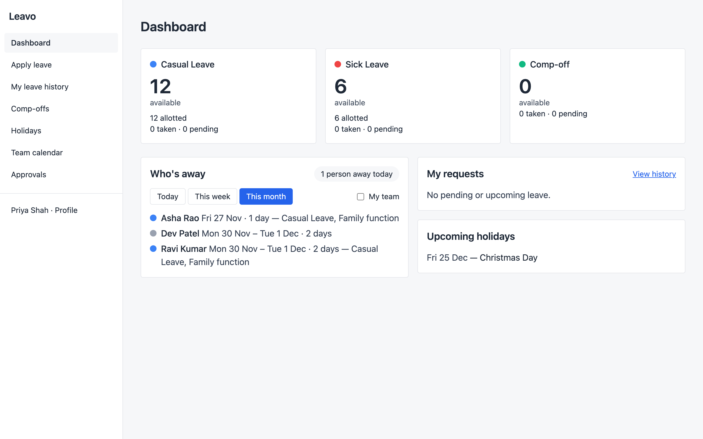

# Leavo

**Open-source, self-hosted leave management.** Passwordless sign-in, leave requests with
one-click email approvals, balances you can trace entry by entry, comp-offs, a holiday calendar,
year-end carry forward and an import from Keka — in one Docker image with PostgreSQL.

> The product name is provisional and will change before the first public release.



## What it does

- **Employees** apply for full or half days, see live balances and who is away, cancel, earn and
  spend comp-offs, and download their own data.
- **Approvers** decide from the inbox or straight from the email, seeing balance and team
  conflicts; started leave can be cancelled with approval.
- **Admins** set leave types and quotas (restricted types such as maternity leave by grant),
  holidays (country packs, CSV, copy last year), approver groups, people and imports; adjust
  balances with a reason; run reports; read the audit log; preview year-end carry forward.
- **Operators** run one image, get safe migrations, metrics, a recovery sign-in when email is
  down, backups that are just PostgreSQL plus one folder, and no telemetry.

## Quick start

```bash
curl -LO https://github.com/leavo-hq/leavo/releases/latest/download/docker-compose.yml
curl -LO https://github.com/leavo-hq/leavo/releases/latest/download/.env.example && mv .env.example .env
# fill in .env (database password, public URL, secret key, SMTP), then:
docker compose up -d && docker compose logs leavo | grep "Setup token"
```

Open your URL, enter the setup token, and the wizard creates your organization. The
[operator guide](docs/book/src/quickstart.md) covers HTTPS, cloud platforms, upgrades, backups and
monitoring.

## Develop

Rust (stable), Node (LTS) and Docker. See [CONTRIBUTING.md](CONTRIBUTING.md).

```bash
docker compose -f compose.dev.yml up -d     # PostgreSQL + Mailpit (http://localhost:8025)
cargo run -p leavo-api -- serve             # API on :8080, prints the setup token
(cd web && npm ci && npm run dev)           # web app on :5173
```

The design lives in [specs/001-leave-management-v1](specs/001-leave-management-v1/): the
specification, plan, data model, API contract and task list.

## Status

v1 is feature-complete and in final review. Licence: to be decided (AGPL-3.0 or MIT) before the
first release. Security issues: see [SECURITY.md](SECURITY.md).
